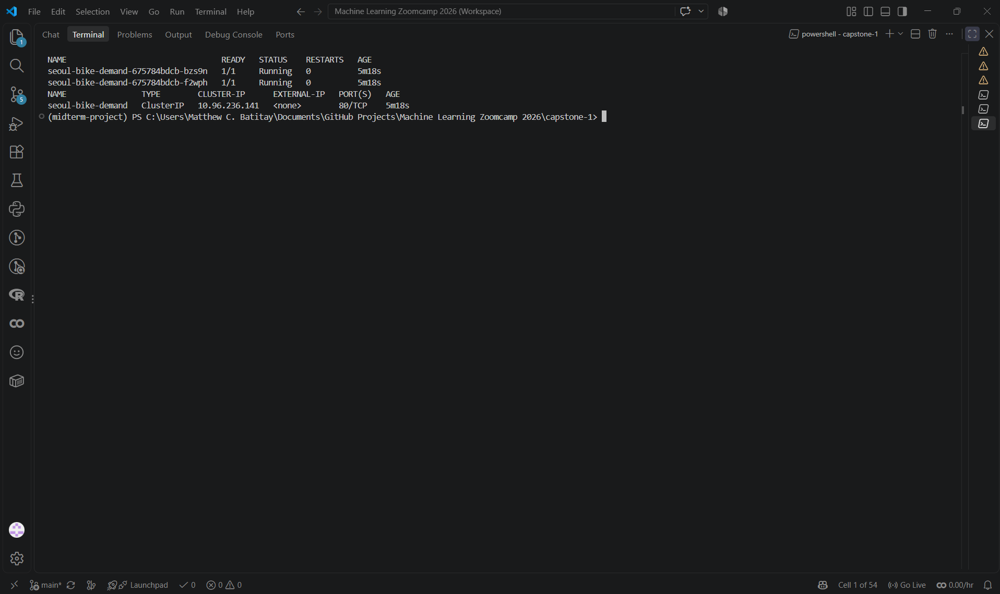
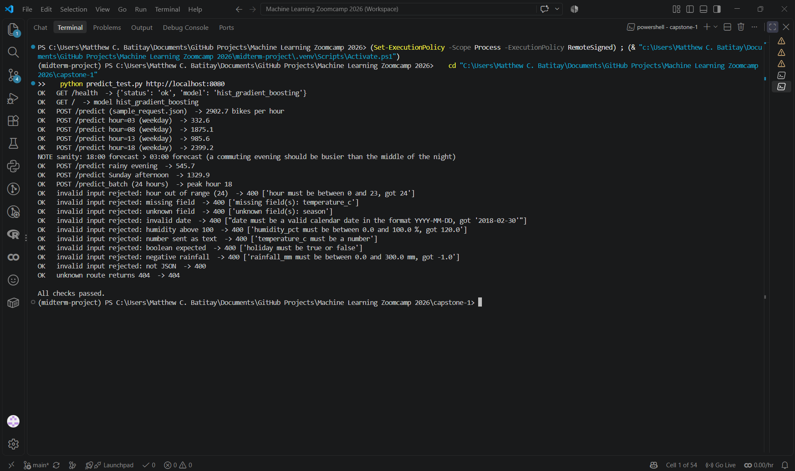

# Seoul Bike Sharing Demand: hourly rental forecast

Machine Learning Zoomcamp 2026, **Capstone 1**. A regression model and a small web service that forecast how many public bikes will be rented in Seoul in a given hour, from the calendar (date, hour, public holiday) and the weather for that hour.

- **Data:** UCI *Seoul Bike Sharing Demand*, 8,760 hourly records (1 December 2017 to 30 November 2018), CC BY 4.0.
- **Models compared:** ridge regression, decision tree, random forest and gradient-boosted trees, with hyper-parameter tuning.
- **Validation:** chronological hold-out plus blocked cross-validation, because hourly data from neighbouring hours must not be split randomly.
- **Result:** gradient-boosted trees were selected; on the hold-out period (11 September to 30 November 2018) they forecast hourly rentals with an RMSE of 320.8 bikes per hour (R² 0.71), against 434.7 for the average of the same hour and day type.
- **Serving:** Flask API (single and batch prediction), Docker image and Kubernetes manifests, tested in Docker and on a local `kind` cluster.

## Problem description

A bike-sharing system only works if bikes are available at the right time and place. With too few bikes, riders walk away; with too many, bikes and the trucks that move them are wasted. How many bikes are rented in an hour depends on the time of day, on whether it is a working day, and strongly on the weather, which is known in advance from a forecast.

This project answers one question:

> *How many bikes will be rented in Seoul in this hour, given the date, the hour, whether it is a public holiday and the weather?*

**How the solution would be used.** A planner (or a script that runs every morning) takes the weather forecast for the next 24 hours up to a week, turns each forecast hour into a record, sends them to `POST /predict_batch` and gets an hourly demand curve back. That curve can drive decisions such as how many bikes to have available at stations before the commuting peaks, and which low-demand hours are the best windows for maintenance and rebalancing. The service reports *citywide* demand per hour; it does not say *where* bikes are needed.

## Dataset

[UCI Machine Learning Repository, Seoul Bike Sharing Demand (id 560)](https://archive.ics.uci.edu/dataset/560/seoul+bike+sharing+demand), licence CC BY 4.0, DOI [10.24432/C5F62R](https://doi.org/10.24432/C5F62R). One row per hour, 365 days x 24 hours = 8,760 rows, 14 columns. The notebook confirms that there are no missing values and no duplicates, and that every day has all 24 hours.

| Column | Meaning | Unit |
|---|---|---|
| Date | calendar day (stored as day/month/year in the file) | |
| **Rented Bike Count** | **target**: bikes rented in that hour | bikes per hour |
| Hour | hour of the day | 0 to 23 |
| Temperature, Dew point temperature | air temperature, dew point | °C |
| Humidity | relative humidity | % |
| Wind speed | wind speed | m/s |
| Visibility | visibility | units of 10 m |
| Solar Radiation | solar radiation | MJ/m² |
| Rainfall, Snowfall | precipitation in the hour | mm, cm |
| Seasons | Winter, Spring, Summer, Autumn | |
| Holiday | public holiday or not | |
| Functioning Day | whether the bike system was operating in that hour | |

The CSV is **not committed**: `python download_data.py` downloads the official zip, extracts `SeoulBikeData.csv` into `data/` and validates the schema (see [Get the data](#2-get-the-data)).

## Approach

The details, with the evidence, are in [`notebook.ipynb`](notebook.ipynb); the logic that is reused for training and serving is in [`common.py`](common.py).

**Data preparation and cleaning**
- The file is latin-1 encoded (the degree sign is a single byte), dates are `dd/mm/yyyy`, and the headers contain units. The loader normalises all of this and stops with a clear message if a column or category is not what it expects.
- Exact duplicate rows are dropped.
- Hours in which the bike system was switched off are dropped (295 hours, 3.4 % of the file: 12 whole days and one partial day). The count is 0 in all of them because bikes could not be rented, which is not demand. The model forecasts demand *given that the service operates*.
- A relative humidity of exactly 0 % does not occur in Seoul and is treated as a missing reading inside the pipeline (median imputation, fitted inside each cross-validation fold), so training and serving behave identically. It affects 17 hours of the file.

**Features** (the first step of the saved scikit-learn `Pipeline`, so the service receives only raw inputs): hour, day of the week, weekend flag, public-holiday flag, a combined "day off" flag, a combined hour-and-day-type category (weekday commuting peaks differ from weekend leisure riding), rain and snow flags, and the eight weather variables. The season label is **not** used: it is a coarse proxy for temperature and sunshine, and almost all autumn days fall in the hold-out period.

**Validation**
- *Test set:* the last 20 % of the calendar days. It is not used for EDA, model selection or tuning, and is scored once.
- *Cross-validation:* 5-fold `GroupKFold` on the training period, where consecutive 7-day blocks always stay together. Shuffled folds would put neighbouring hours (almost identical weather and demand) on both sides of the split and flatter the model; the notebook measures this effect.
- *Metrics:* RMSE (used to select models), MAE, R² and WAPE (total absolute error divided by total demand). Predictions are clipped at 0, exactly as the service returns them.
- *Reference predictors:* the training mean, and the average demand of the same hour and day type, which is what a planner would use without a weather forecast.

**Models and tuning.** Ridge regression (fitted on `log(1 + count)` or on the raw count, whichever cross-validates better; the raw count won, with a cross-validated RMSE of 354.1 against 413.7), decision tree, random forest and gradient-boosted trees (`HistGradientBoostingRegressor`). Ridge uses a grid over the regularisation strength; the tree models use `RandomizedSearchCV` with a fixed seed. For every model the better of the starting values and the searched values is kept. The notebook writes the result to [`params.json`](params.json), and [`train.py`](train.py) re-runs the cross-validation with those parameters, selects the model with the lowest RMSE, scores it once on the test period and **refits it on all days** to produce the deployed `model.bin`.

> The reported test metrics belong to the model trained on the training period only. The deployed model is refit on the full year with the same hyper-parameters (more data, and the autumn days it would otherwise never see), so it can no longer be scored on the test period.

## Results

The numbers come from `python train.py` and are stored in [`reports/metrics.json`](reports/metrics.json); the two tables are `reports/results.md`. All values are bikes per hour except R² and WAPE.

### Cross-validation on the training period (blocked 5-fold, bikes per hour)

| Model | CV RMSE (mean +/- std) | CV MAE | CV R2 |
|---|---|---|---|
| ridge | 354.1 +/- 17.4 | 255.1 | 0.694 |
| decision_tree | 241.9 +/- 21.4 | 149.0 | 0.858 |
| random_forest | 197.4 +/- 21.0 | 122.1 | 0.905 |
| hist_gradient_boosting (selected) | 187.7 +/- 25.3 | 114.5 | 0.914 |

### Hold-out test period (evaluated once)

| Predictor | RMSE | MAE | R2 | WAPE |
|---|---|---|---|---|
| hist_gradient_boosting (selected model) | 320.8 | 242.9 | 0.713 | 27.1 % |
| average of the same hour and day type | 434.7 | 317.7 | 0.473 | 35.5 % |
| overall training average | 633.8 | 490.9 | -0.120 | 54.9 % |

The selected model uses a learning rate of 0.031, 670 boosting iterations, 31 leaves per tree, at least 5 samples per leaf and an L2 penalty of 0.015 (all values are in [`params.json`](params.json)).

**Reading the results**
- **Gradient boosting wins and the linear model is far behind.** Boosted trees and the random forest are close (RMSE 187.7 and 197.4), the single tree is clearly worse (241.9) and ridge regression is the weakest (354.1), as expected for a demand curve whose hourly shape depends on the day type. For ridge the raw count beat `log(1 + count)` (354.1 against 413.7).
- **The weather is worth modelling.** The planner's alternative without a forecast, the average of the same hour and day type, has a cross-validated RMSE of 538.4 against 187.7 for the model. On the hold-out period the model lowers the RMSE of that reference from 434.7 to 320.8 (-26 %) and its MAE from 317.7 to 242.9 (-24 %).
- **The hold-out period is much harder than the cross-validation folds** (RMSE 320.8 and R² 0.713, against 187.7 and 0.914), and most of the extra error is a *level shift*, not noise: the model under-forecasts almost everywhere (on average about 180 bikes per hour on dry hours, 207 on working days and 328 in the 16:00 to 19:00 window). The test days average about 895 rentals per hour against about 688 in the training period, and the training period contains only ten days of autumn. With a single year of data a seasonal effect cannot be separated from growth of the service. The deployed model is refit on all days and has therefore seen autumn, but how well it forecasts the next autumn cannot be measured with this data.
- **Where it errs.** In absolute terms the errors are largest in the commuting peaks (MAE 314 from 06:00 to 09:00, 399 from 16:00 to 19:00) and smallest at night; relative to demand (WAPE) midday is best (21.5 %). Rainy hours are the weakest spot: the model over-forecasts them (+62 on average, WAPE 96 %, only 74 hours).
- **What drives the forecast** (permutation importance on the test period, the increase of the RMSE when one input is shuffled): hour of the day (+302), temperature (+195), solar radiation (+91), day of the week (+57), humidity (+48), rainfall (+27) and public holiday (+17). Visibility, dew point (largely redundant with temperature and humidity), snowfall and wind speed add little or nothing.
- **Shuffled folds flatter the model.** With shuffled instead of blocked folds the cross-validated RMSE drops from 187.7 to 155.9 (-17 %): the optimism that the blocked scheme avoids.
- **The data are as clean as UCI states**, apart from the cases the cleaning rules handle (295 closed hours, 17 hours with a humidity of 0 %). On working days demand peaks at 18:00 (about 1,660 bikes per hour on average in the training period) and is lowest at 04:00 (about 115); on days off it peaks at 17:00 (about 1,050).

## Repository layout

```
capstone-1/
├── README.md               this file
├── notebook.ipynb          data checks, cleaning, EDA, feature importance, model selection, tuning
├── common.py               schema, cleaning, features, pipelines, metrics, input validation
├── download_data.py        downloads the dataset from UCI and validates it
├── train.py                trains the final model -> model.bin, reports/metrics.json, reports/results.md
├── predict.py              Flask service
├── predict_test.py         smoke test for a running service (standard library only)
├── params.json             hyper-parameters per model (written by the notebook, read by train.py)
├── sample_request.json     example request
├── requirements.txt        runtime and training dependencies (pinned)
├── requirements-dev.txt    + notebook tooling (matplotlib, seaborn, jupyter)
├── Dockerfile  .dockerignore
├── deployment/k8s/         Kubernetes Deployment and Service
├── tests/                  unit tests (standard library unittest, no network needed)
├── reports/                metrics written by train.py
└── data/  model.bin        created locally, not committed
```

## Run it yourself

Everything below is run from the `capstone-1` folder. Use **Python 3.11**, the version the pinned dependencies and the Docker image are built for.

### 1. Create the environment

Windows PowerShell:

```powershell
cd capstone-1
uv venv --python 3.11 .venv          # or:  py -3.11 -m venv .venv
.venv\Scripts\Activate.ps1           # if scripts are blocked:  Set-ExecutionPolicy -Scope Process -ExecutionPolicy Bypass
uv pip install -r requirements-dev.txt   # or:  python -m pip install -r requirements-dev.txt
```

macOS / Linux:

```bash
cd capstone-1
python3.11 -m venv .venv
source .venv/bin/activate
python -m pip install -r requirements-dev.txt
```

`requirements.txt` is enough to train and serve; `requirements-dev.txt` adds what the notebook needs. In VS Code, select the interpreter `.venv` (Windows: `.venv\Scripts\python.exe`) as the notebook kernel.

### 2. Get the data

```powershell
python download_data.py
```

It downloads the official zip from UCI, saves `data/SeoulBikeData.csv` and checks the schema and the row count. If the download is blocked, get the zip from the [dataset page](https://archive.ics.uci.edu/dataset/560/seoul+bike+sharing+demand) and run `python download_data.py --from-zip <the zip you downloaded>` (or `--from-csv <the csv>`).

### 3. Run the notebook

Open `notebook.ipynb` in VS Code or Jupyter and run all cells, or execute it from the command line:

```powershell
python -m nbconvert --to notebook --execute --inplace --ExecutePreprocessor.timeout=-1 notebook.ipynb
```

It takes several minutes, mostly for the hyper-parameter searches, and writes `params.json`. On Windows, red `KeyError ... joblib_memmapping_folder` messages at the end are harmless cleanup noise from joblib; success is the line saying the notebook was written.

### 4. Train the final model

```powershell
python train.py
```

It prints the cross-validated scores of the four models, the selected model and its score on the test period, then saves `model.bin` (the whole fitted pipeline plus metadata) and the reports in `reports/`. `train.py` warns if `params.json` still holds untuned starting values.

### 5. Run the service

```powershell
python predict.py                    # http://localhost:9696   (development server)
```

On Linux or macOS the production server can be used instead: `gunicorn --bind 0.0.0.0:9696 predict:app` (gunicorn does not run on Windows; the Docker image uses it).

### 6. Test the service

In a second terminal (with the environment activated):

```powershell
python predict_test.py               # about twenty checks: valid requests, invalid requests, 404
```

Or send a request yourself.

```powershell
# PowerShell
Invoke-RestMethod -Method Post -Uri http://localhost:9696/predict -ContentType "application/json" -Body (Get-Content sample_request.json -Raw)
```

```bash
# curl (in PowerShell use curl.exe)
curl -s -X POST http://localhost:9696/predict -H "Content-Type: application/json" -d @sample_request.json
```

### 7. Unit tests

```powershell
python -m unittest discover -s tests -v
```

The tests use a synthetic data set that mimics the format of the real file (header, encoding, date format, categories), so they need neither the download nor an internet connection. They cover the loader and cleaning rules, the chronological split, the feature engineering, the agreement of the training and serving paths, the input validation, `train.py`, the download script and every API endpoint. The synthetic numbers are meaningless and are never used for results.

### Troubleshooting

- `Jupyter command ... jupyter.exe not found` on Windows: use `python -m nbconvert ...` as shown in step 3.
- `ImportError: DLL load failed while importing _imaging: An Application Control policy has blocked this file` (Pillow, which matplotlib needs): Windows Application Control blocked a freshly installed file. The unit tests, `train.py` and the service do not use matplotlib; for the notebook, use an environment in which matplotlib already imports, for example another project's virtual environment with the same pinned versions.
- At the end of the notebook run, `KeyError ... joblib_memmapping_folder` messages and a seaborn `FutureWarning` about `SeriesGroupBy.grouper` are harmless.

## API

| Method and path | Purpose |
|---|---|
| `GET /` | model summary (name, training period, ranges seen in training, hold-out scores) and the input fields |
| `GET /health` | liveness / readiness probe |
| `POST /predict` | one record to `predicted_rentals` |
| `POST /predict_batch` | `{"records": [...]}` with 1 to 168 records (one week of hours) |

**Input record**

| Field | Type | Allowed values | Meaning |
|---|---|---|---|
| `date` | string | `YYYY-MM-DD` | calendar date (only its day of the week is used) |
| `hour` | integer | 0 to 23 | hour of the day |
| `holiday` | boolean | `true` / `false` | public holiday in Seoul |
| `temperature_c` | number | -50 to 60 | air temperature, °C |
| `humidity_pct` | number | 0 to 100 | relative humidity, % |
| `wind_speed_ms` | number | 0 to 60 | wind speed, m/s |
| `visibility_10m` | number | 0 to 10000 | visibility, units of 10 m |
| `dew_point_c` | number | -60 to 40 | dew point, °C |
| `solar_radiation_mj_m2` | number | 0 to 6 | solar radiation in the hour, MJ/m² |
| `rainfall_mm` | number | 0 to 300 | rainfall in the hour, mm |
| `snowfall_cm` | number | 0 to 100 | snowfall in the hour, cm |

**Example** (`sample_request.json`, a summer weekday at 18:00)

```json
{"date": "2018-07-18", "hour": 18, "holiday": false, "temperature_c": 28.4, "humidity_pct": 55,
 "wind_speed_ms": 1.8, "visibility_10m": 1800, "dew_point_c": 18.5, "solar_radiation_mj_m2": 0.45,
 "rainfall_mm": 0, "snowfall_cm": 0}
```

The response to that request, from the Docker image:

```json
{"predicted_rentals": 2902.7, "unit": "bikes per hour", "model": "hist_gradient_boosting", "warnings": []}
```

- Validation is strict: unknown or missing fields, wrong types (a number sent as text, a boolean sent as a number), out-of-range values and impossible dates return **HTTP 400** with the list of problems in `details`. Errors, including 404 and 405, are always JSON.
- `warnings` does not block a request. It lists inputs outside the range seen in training (the model is then extrapolating) and a dew point above the air temperature.
- `POST /predict_batch` returns `{"count": n, "predictions": [{"index": 0, "predicted_rentals": ..., "warnings": [...]}, ...]}`; one invalid record rejects the whole batch and the response says which record.

## Docker

The image downloads the data and trains the model while it is built, so a fresh clone needs only Docker and internet access. It runs as an unprivileged user with gunicorn and has a health check.

```powershell
docker build -t seoul-bike-demand:1.0 .
docker run --rm -p 9696:9696 seoul-bike-demand:1.0
python predict_test.py http://localhost:9696
```

Stop `python predict.py` first if it is using port 9696, or publish another port (`-p 9697:9696`). The `PORT` environment variable changes the listening port.

## Kubernetes (local `kind` cluster)

```powershell
kind create cluster --name seoul-bike
kind load docker-image seoul-bike-demand:1.0 --name seoul-bike     # the image is built above, never pulled
kubectl apply -f deployment/k8s/
kubectl rollout status deployment/seoul-bike-demand
kubectl get pods                                                    # two pods, READY 1/1, STATUS Running
kubectl port-forward service/seoul-bike-demand 8080:80             # keep this terminal open
python predict_test.py http://localhost:8080                        # in a second terminal
kind delete cluster --name seoul-bike                               # when finished
```

[`deployment/k8s/deployment.yaml`](deployment/k8s/deployment.yaml) runs two replicas with readiness and liveness probes on `/health` and resource requests and limits. [`deployment/k8s/service.yaml`](deployment/k8s/service.yaml) exposes them inside the cluster on port 80.

Both pods are `Running` and ready, and the smoke test passes through the port-forward:





### Public cloud (Google Cloud Run), documented but not run

The Dockerfile already listens on the `PORT` that Cloud Run provides, so the same image can be deployed from this folder with the Google Cloud CLI (a Google Cloud project with billing enabled is required):

```bash
gcloud run deploy seoul-bike-demand --source . --region asia-southeast1 --memory 1Gi --allow-unauthenticated
```

The command prints the service URL; `python predict_test.py <that URL>` checks it.

## Verification

Run on a Windows machine with Python 3.11 and the pinned package versions (numpy 2.3.3, pandas 2.3.2, scikit-learn 1.7.2, Flask 3.1.3):

- `python -m unittest discover -s tests`: 85 tests, all passing.
- `python download_data.py`, `notebook.ipynb` (all cells executed, outputs saved in the notebook) and `python train.py` ran end to end on the real data.
- `python predict_test.py` passes against the local service, against the Docker container (reported `healthy`) and against the Kubernetes service through a port-forward. All three return the same forecasts (for example 2902.7 bikes per hour for `sample_request.json`).

Commands, outputs and versions are in [`deployment/verification.md`](deployment/verification.md).

## Design decisions and limitations

**Decisions**
- *Chronological test set and blocked cross-validation* instead of random splits: the question is "how well does the model forecast days it has not seen", and hourly data from the same day are nearly duplicates of each other.
- *No season feature*: see the approach section. Weather already carries most of the seasonal signal.
- *Gradient boosting from scikit-learn* (`HistGradientBoostingRegressor`) instead of XGBoost: the same family of models without an extra dependency, which keeps the pinned environment and the Docker image small.
- *One saved object*: the pipeline contains feature engineering, preprocessing and the model, so the service cannot drift away from training. `model.bin` is a pickle written by `train.py`; only load model files you created yourself.
- *Warnings instead of rejections* for inputs outside the training range: a forecast service should not refuse a heat wave, but it should say that it is extrapolating.

**Limitations**
- One year of data from one city. There is no information about growth of the system or yearly trends, and a model used in practice would be retrained regularly on recent data.
- The weather in the dataset is *observed* weather. With a real forecast as input, forecast errors add to the model's error; the scores here assume accurate weather.
- Citywide hourly totals only: no stations, no locations.
- Forecasts are conditional on the system operating, and the public-holiday flag must be supplied by the client.
- The hold-out period is a single block of days (mostly autumn). The scores say how well the model forecasts that period, not every season, and the model under-forecasts that period (see Results). The deployed model has seen autumn, but its autumn accuracy cannot be measured with one year of data.

## Evaluation criteria

| Criterion | Where to look |
|---|---|
| Problem description | [Problem description](#problem-description) |
| EDA | `notebook.ipynb` sections 2 and 5 (value ranges, missing values, target analysis, correlations, mutual information) and section 10 (feature importance) |
| Model training | `notebook.ipynb` sections 6 to 8: linear and tree-based models, hyper-parameter tuning |
| Exporting notebook to script | [`train.py`](train.py) and [`common.py`](common.py) |
| Reproducibility | [`download_data.py`](download_data.py), [run it yourself](#run-it-yourself), pinned [`requirements.txt`](requirements.txt), fixed seed 42 |
| Model deployment | [`predict.py`](predict.py), [API](#api), [`predict_test.py`](predict_test.py) |
| Dependency and environment management | [`requirements.txt`](requirements.txt), [`requirements-dev.txt`](requirements-dev.txt), [create the environment](#1-create-the-environment) |
| Containerization | [`Dockerfile`](Dockerfile), [Docker](#docker) |
| Cloud deployment | [`deployment/k8s/`](deployment/k8s/), [Kubernetes](#kubernetes-local-kind-cluster) with screenshots, [`deployment/verification.md`](deployment/verification.md) |

## Data licence and citation

The dataset is licensed under [CC BY 4.0](https://creativecommons.org/licenses/by/4.0/). Citation, as given by the UCI repository:

> Seoul Bike Sharing Demand [Dataset]. (2020). UCI Machine Learning Repository. https://doi.org/10.24432/C5F62R.
