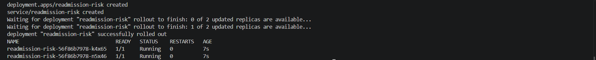
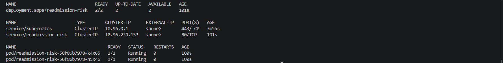
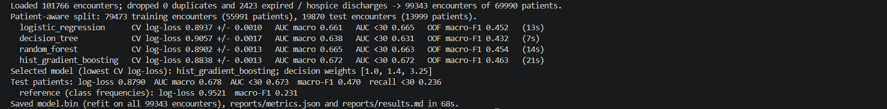
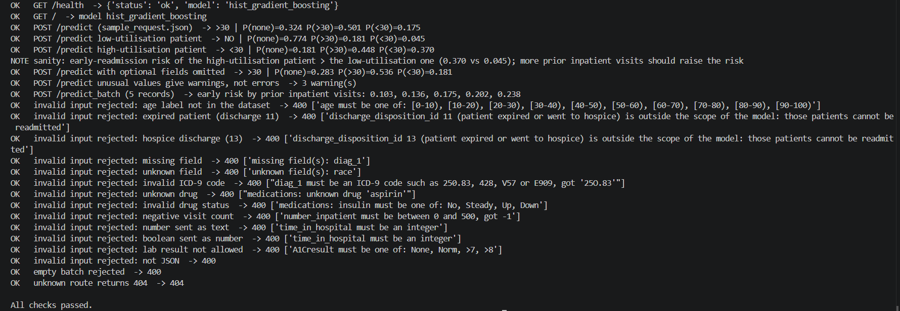

# Hospital readmission risk for diabetes patients

Machine Learning Zoomcamp 2026, **Capstone 2**. A three-class classification model and a small web service that estimate, at the moment a hospitalised diabetes patient is discharged, whether the patient will **not be readmitted**, be readmitted **after more than 30 days**, or be readmitted **within 30 days**.

- **Data:** UCI *Diabetes 130-US Hospitals for Years 1999-2008*, 101,766 hospital encounters of 71,518 patients, 50 columns, CC BY 4.0.
- **Models compared:** logistic regression, decision tree, random forest and gradient-boosted trees, with hyper-parameter tuning.
- **Validation:** hold-out test set and cross-validation that keep **all encounters of a patient together**, stratified by class, because the same patient appears in several rows.
- **Serving:** Flask API (single and batch prediction) returning class probabilities, a decision and warnings; Docker image and Kubernetes manifests.
- **Status:** complete and verified end to end: unit tests, the executed notebook, training, the local service, the Docker image and a two-replica deployment on a local Kubernetes cluster have all been run (see [Results](#results) and [Verification](#verification)).

> **Intended use.** A decision-support demonstration trained on 1999-2008 US hospital data. It is not a medical device and must not be used for clinical decisions.

## Problem description

When a hospital discharges a patient with diabetes, some of them come back: a readmission within 30 days is a widely used hospital quality measure (US Medicare penalises excess readmissions for some conditions), and it often points to a problem in the transition from the hospital to home. Care teams can reduce early readmissions with extra follow-up, medication reconciliation or a home-health visit, but those resources are limited, so they have to go to the patients who need them most.

This project answers one question:

> *Given what is known about a diabetes patient's stay at the moment of discharge, how likely is each outcome: no readmission, readmission after more than 30 days, or readmission within 30 days?*

**How the solution would be used.** At discharge, the hospital's system sends the encounter's routine data (age group, length of stay, diagnoses, lab and medication counts, prior visits, discharge destination, diabetes medications) to `POST /predict`. The service returns the three probabilities, the decision of the model and, as a separate number, the probability of an early readmission, which can be compared with the average (`early_risk_vs_average`). A transitional-care team that can follow up only a limited share of patients ranks the day's discharges by that probability and starts with the highest. The decision weights stored with the model give a ready-made yes/no flag for the class `<30`; how many patients to flag is a capacity and cost decision that the ranking leaves to the team.

The task is hard: the information available at discharge is expected to predict early readmission only moderately. The evaluation therefore reports the quality of the probabilities (log-loss, ROC-AUC, PR-AUC) next to the quality of the decisions (per-class precision and recall, macro-F1, confusion matrix), with a reference predictor that has no information.

## Dataset

[UCI Machine Learning Repository, Diabetes 130-US Hospitals for Years 1999-2008 (id 296)](https://archive.ics.uci.edu/dataset/296/diabetes-130-us-hospitals-for-years-1999-2008), licence CC BY 4.0, DOI [10.24432/C5230J](https://doi.org/10.24432/C5230J). Ten years of clinical records from 130 US hospitals: 101,766 diabetic encounters with a stay of 1 to 14 days during which lab tests were performed and medications were given.

| Group | Columns | Meaning |
|---|---|---|
| Identifiers | `encounter_id`, `patient_nbr` | one row per encounter; a patient can have several encounters |
| Target | `readmitted` | `NO` not readmitted, `>30` readmitted after more than 30 days, `<30` readmitted within 30 days |
| Patient | `race`, `gender`, `age` | age in 10-year groups such as `[70-80)` |
| Admission and discharge | `admission_type_id`, `admission_source_id`, `discharge_disposition_id`, `payer_code`, `medical_specialty` | coded; meanings in `IDS_mapping.csv` of the download |
| Stay | `time_in_hospital`, `num_lab_procedures`, `num_procedures`, `num_medications`, `number_diagnoses` | counts and days |
| History | `number_outpatient`, `number_emergency`, `number_inpatient` | visits in the year before the encounter |
| Diagnoses | `diag_1`, `diag_2`, `diag_3` | ICD-9 codes |
| Lab results | `max_glu_serum`, `A1Cresult` | `None` = test not performed |
| Medications | 23 drug columns (`metformin`, `insulin`, ...), `change`, `diabetesMed` | `No`, `Steady`, `Up`, `Down` |
| Not usable | `weight` | missing for about 97 % of the encounters |

The CSV is **not committed**: `python download_data.py` downloads the official zip, extracts `diabetic_data.csv` into `data/` and validates the schema (see [Get the data](#2-get-the-data)).

## Approach

The details, with the evidence, are in [`notebook.ipynb`](notebook.ipynb); the logic that is reused for training and serving is in [`common.py`](common.py).

**Data preparation and cleaning**
- The file is read as text first. The value `None` (a lab test that was not performed) and `NO` (not readmitted) are real values; a default `read_csv` would silently turn them into missing values. The file's own missing-value marker `?` becomes a real missing value.
- Exact duplicate rows and repeated encounter ids are dropped (none are expected in the original file; the rule protects against a damaged copy).
- **Encounters that ended in death or hospice care are dropped** (`discharge_disposition_id` 11, 13, 14, 19, 20, 21): those patients cannot be readmitted, so they are not examples of "not readmitted" and would teach the model that being close to death means low risk. The notebook and `train.py` print how many rows this removes.
- Several encounters of the same patient are kept, but never split across train and test (see Validation).
- `weight` and the identifiers are not used. `payer_code` and `medical_specialty` are missing for a large share of the encounters; *missing* becomes its own level.

**Features** (the first step of the saved scikit-learn `Pipeline`, so the service receives only raw inputs): the counts, the age-group mid-point, the total number of prior visits, the number of active and of changed diabetes drugs, `insulin` and `metformin` status, the three diagnoses grouped into nine ICD-9 families (circulatory, respiratory, digestive, diabetes, injury, musculoskeletal, genitourinary, neoplasms, other), lab results, and the admission and discharge codes (not-available codes merged into one level; categories with fewer than 100 training rows pooled).
**`race` and `gender` are deliberately not inputs of the model.** They stay in the cleaned table so that the notebook can audit whether the model behaves differently for different groups.

**Validation**
- *Test set:* one fold of a stratified, patient-grouped 5-fold split (about 20 % of the patients, with every encounter of those patients). It is not used for EDA, model selection or tuning and is scored once.
- *Cross-validation:* stratified, patient-grouped 5-fold on the training patients. A random row split would put a patient's earlier stay in the training data and the next stay in the test data; the notebook measures how much this flatters the model.
- *Metrics:* multi-class log-loss (used to select the model; it rewards honest probabilities, which the service returns), ROC-AUC (macro one-vs-rest, and for `<30` alone), PR-AUC for `<30`, and, for the decisions, per-class precision and recall, macro-F1, balanced accuracy and the confusion matrix.
- *Reference predictor:* the training class frequencies (no information).

**Probabilities first, decisions second.** The models are trained on the natural class frequencies. Because only about one encounter in nine is an early readmission, the arg-max of honest probabilities almost never says `<30`. The decision rule is therefore `argmax(weight x probability)` with weight 1 for `NO` and two weights for `>30` and `<30`, chosen on the **out-of-fold** predictions of the training patients to maximise macro-F1. The weights move the operating point between recall and precision; they do not change the ranking quality of the model. The notebook plots that trade-off.

**Models and tuning.** Logistic regression, decision tree, random forest and gradient-boosted trees (`HistGradientBoostingClassifier`). Tuning runs on a sample of whole patients (about 30,000 encounters, 3 patient-grouped folds) with log-loss as the score: a grid for the logistic regression and `RandomizedSearchCV` with a fixed seed for the tree models; for every model the better of the starting values and the searched values is kept. The notebook writes the result to [`params.json`](params.json); [`train.py`](train.py) re-runs the cross-validation of all four models with those parameters on all training patients, selects the model with the lowest log-loss, tunes the decision weights on its out-of-fold predictions, scores it once on the test patients and **refits it on all patients** to produce the deployed `model.bin`.

> The reported test metrics belong to the model trained on the training patients only. The deployed model is refit on all patients with the same hyper-parameters, so it can no longer be scored on the test patients.

## Results

All numbers come from a real run (Python 3.11.15, numpy 2.3.3, pandas 2.3.2, scikit-learn 1.7.2, seed 42) and are stored in [`reports/metrics.json`](reports/metrics.json) and [`reports/results.md`](reports/results.md); the figures and tables behind the findings are in the executed [`notebook.ipynb`](notebook.ipynb). Other machines or library versions can differ in the last decimals.

**Data after cleaning.** 101,766 encounters were loaded; no duplicates were found and **2,423 encounters of patients who died or went to hospice were removed**, leaving 99,343 encounters of 69,990 patients. Classes: not readmitted 52,527 (52.9 %), readmitted after more than 30 days 35,502 (35.7 %), readmitted within 30 days 11,314 (11.4 %). The hold-out set holds 19,870 encounters of 13,999 patients (20 % of the patients), the training set 79,473 encounters of 55,991 patients; the class shares of the two sets agree to three decimals and no patient is in both.

### Model comparison (cross-validation on the training patients, patient-grouped, 5 folds)

| Model | Log-loss (mean +/- std) | ROC-AUC macro | ROC-AUC for `<30` | PR-AUC for `<30` | Out-of-fold macro-F1 |
|---|---|---|---|---|---|
| logistic regression | 0.894 +/- 0.001 | 0.661 | 0.665 | 0.208 | 0.452 |
| decision tree | 0.906 +/- 0.002 | 0.638 | 0.631 | 0.187 | 0.432 |
| random forest | 0.890 +/- 0.001 | 0.665 | 0.663 | 0.215 | 0.454 |
| **gradient boosting (selected)** | **0.884 +/- 0.001** | **0.672** | **0.672** | **0.224** | **0.463** |
| training class frequencies (no information) | 0.952 | 0.500 | 0.500 | 0.114 | 0.231 |

Gradient boosting has the lowest log-loss and the best ranking of early readmissions. The tuned parameters are `learning_rate` 0.03, `max_iter` 150, `max_leaf_nodes` 15, `min_samples_leaf` 200 and `l2_regularization` 10. The gains of tuning over the starting values were small (for the gradient boosting 0.8914 to 0.8899 log-loss on the tuning sample; the random forest improved most, 0.9036 to 0.8964), so the starting values were already reasonable. Even the logistic regression is close to the best model: with these inputs the achievable signal is limited, and a more flexible model adds only a little.

### Hold-out test patients (evaluated once)

| Predictor | Log-loss | ROC-AUC macro | ROC-AUC for `<30` | PR-AUC for `<30` | Macro-F1 | Balanced accuracy | Accuracy |
|---|---|---|---|---|---|---|---|
| gradient boosting (selected) | 0.879 | 0.678 | 0.673 | 0.229 | 0.470 | 0.468 | 0.557 |
| training class frequencies (no information) | 0.952 | 0.500 | 0.500 | 0.114 | 0.231 | 0.333 | 0.529 |

The test scores agree with the cross-validated ones (log-loss 0.879 against 0.884, ROC-AUC for `<30` 0.673 against 0.672), so there is no sign of over-fitting to the validation folds. The decision weights (NO, >30, <30) are 1, 1.4 and 3.25.

| Class | Precision | Recall | F1 | Test encounters | Predicted |
|---|---|---|---|---|---|
| NO | 0.661 | 0.659 | 0.660 | 10,506 | 10,473 |
| >30 | 0.487 | 0.508 | 0.498 | 7,101 | 7,406 |
| <30 | 0.268 | 0.236 | 0.251 | 2,263 | 1,991 |

| true \ predicted | NO | >30 | <30 |
|---|---|---|---|
| NO | 6,925 | 2,875 | 706 |
| >30 | 2,740 | 3,610 | 751 |
| <30 | 808 | 921 | 534 |

### What these numbers mean

- **The model has real but moderate skill.** The ROC-AUC for an early readmission is 0.673 (0.5 is chance) and the PR-AUC is 0.229, twice the 0.114 that a model without information obtains. The probabilities are well calibrated: in the out-of-fold reliability plot the observed share of early readmissions follows the predicted probability closely across the whole range.
- **It is not a reliable yes/no classifier.** With the chosen weights, about one in four patients flagged as `<30` is really readmitted early (precision 0.27) and about one in four early readmissions is found (recall 0.24). Accuracy (0.557) is only slightly above the 0.529 of always answering "not readmitted", which is why the evaluation relies on log-loss, AUC, macro-F1 and per-class results instead.
- **It is useful for ranking.** Ordering the test discharges by the predicted probability of an early readmission and flagging only the highest-ranked share gives:

| Flagged share of discharges | Early readmissions caught | Precision among flagged | Lift over random |
|---|---|---|---|
| top 5 % | 14.4 % | 32.7 % | 2.9 x |
| top 10 % | 23.7 % | 27.0 % | 2.4 x |
| top 20 % | 39.0 % | 22.2 % | 1.9 x |
| top 30 % | 51.0 % | 19.4 % | 1.7 x |
| top 50 % | 70.7 % | 16.1 % | 1.4 x |

  A transitional-care team that can follow up 10 % of discharges would reach about a quarter of the early readmissions with this ranking, against a tenth by chance. How far down the list to go is a capacity and cost decision.
- **Prior hospital use is the strongest signal.** In the training patients the share of early readmissions grows from 8.6 % for patients with no inpatient visit in the previous year to 13.3 %, 18.1 %, 20.7 % and 24.0 % for one to four, and 37.2 % for five or more (any readmission: 39 % to 85 %). Permutation importance on the test patients agrees: shuffling `number_inpatient` raises the log-loss by 0.049 and lowers the AUC for `<30` by 0.066, far more than any other input; next come `discharge_disposition_id` (0.014; AUC drop 0.051), `admission_source_id` (0.007), `number_outpatient` (0.006), `number_emergency` (0.006), `number_diagnoses`, the admitting specialty, age, the payer and the primary diagnosis (0.003 to 0.005 each). HbA1c measurement, drug changes and the individual drugs matter little.
- **Subgroup audit (test patients).** Race and gender are not inputs, and the mean predicted probability tracks the observed early-readmission rate in the large groups (for example 11.6 % predicted against 11.4 % observed for African American patients, 11.4 % against 11.7 % for Caucasian patients, 11.7 % against 11.6 % for women, 11.1 % against 11.1 % for men). The ranking is somewhat weaker for African American patients (ROC-AUC 0.641) than for Caucasian patients (0.679), and recall of `<30` is 0.21 against 0.25; the groups for Hispanic patients (399 encounters) and for patients without a recorded race (415) are too small for conclusions. By gender the results are similar (AUC 0.666 and 0.680). The ranking quality falls with age (ROC-AUC 0.74 for 30 to 40 years down to 0.58 for 90 to 100 years). These gaps are worth monitoring in any real use.
- **Patient-aware validation matters less here than expected.** Cross-validating the selected model on the tuning sample with ordinary shuffled folds instead of patient-grouped folds changed the log-loss by only 0.0005 and the AUC for `<30` by 0.0026 in the optimistic direction. The patient-aware design is still the right one (46 % of the encounters belong to the 16,773 patients with more than one encounter), but with these inputs and this model the leakage is small.

The deployed `model.bin` is refit on all 99,343 encounters with the same parameters, so it cannot be scored on the test patients; the test scores above belong to the model trained on the training patients only.

**Example.** `sample_request.json` (a 70-year-old with heart failure and two prior inpatient visits) gives about 32 % for no readmission, 50 % for readmission after more than 30 days and 17.5 % for readmission within 30 days, so the decision is `>30`; the probability of an early readmission is about 1.5 times the average. A low-utilisation patient (no prior visits, 2 days in hospital) gets 4.5 % for an early readmission and a high-utilisation patient (six prior inpatient visits) 37 %.

## Repository layout

```
capstone-2/
├── README.md               this file
├── notebook.ipynb          data checks, cleaning, EDA, feature importance, model selection, tuning, audit
├── common.py               schema, cleaning, features, pipelines, metrics, input validation
├── download_data.py        downloads the dataset from UCI and validates it
├── train.py                trains the final model -> model.bin, reports/metrics.json, reports/results.md
├── predict.py              Flask service
├── predict_test.py         smoke test for a running service (standard library only)
├── params.json             hyper-parameters per model (written by the notebook, read by train.py)
├── sample_request.json     example request
├── requirements.txt        runtime and training dependencies (pinned)
├── requirements-dev.txt    + notebook tooling (matplotlib, seaborn, jupyter)
├── Dockerfile  .dockerignore
├── deployment/k8s/         Kubernetes Deployment and Service
├── deployment/verification.md  record of the runs
├── tests/                  unit tests (standard library unittest, no network needed)
├── reports/                metrics written by train.py
├── images/                 screenshots of the runs
└── data/  model.bin        created locally, not committed
```

## Run it yourself

Everything below is run from the `capstone-2` folder. Use **Python 3.11**, the version the pinned dependencies and the Docker image are built for.

### 1. Create the environment

Windows PowerShell:

```powershell
cd capstone-2
uv venv --python 3.11 .venv          # or:  py -3.11 -m venv .venv
.venv\Scripts\Activate.ps1           # if scripts are blocked:  Set-ExecutionPolicy -Scope Process -ExecutionPolicy Bypass
uv pip install -r requirements-dev.txt   # or:  python -m pip install -r requirements-dev.txt
python -c "import matplotlib.pyplot, seaborn; print('matplotlib ok')"
```

macOS / Linux:

```bash
cd capstone-2
python3.11 -m venv .venv
source .venv/bin/activate
python -m pip install -r requirements-dev.txt
```

`requirements.txt` is enough to train and serve; `requirements-dev.txt` adds what the notebook needs. In VS Code, select the interpreter `.venv` (Windows: `.venv\Scripts\python.exe`) as the notebook kernel.

### 2. Get the data

```powershell
python download_data.py
```

It downloads the official zip from UCI (about 3 MB), saves `data/diabetic_data.csv` and checks the schema and the row count. If the download is blocked, get the zip from the [dataset page](https://archive.ics.uci.edu/dataset/296/diabetes-130-us-hospitals-for-years-1999-2008) and run `python download_data.py --from-zip <the zip you downloaded>` (or `--from-csv <the csv>`).

### 3. Run the notebook

Open `notebook.ipynb` in VS Code or Jupyter and run all cells, or execute it from the command line:

```powershell
python -m nbconvert --to notebook --execute --inplace --ExecutePreprocessor.timeout=-1 notebook.ipynb
```

It prints nothing until it is done. In the reference run it took under ten minutes; allow up to 30 minutes on a machine with few CPU cores. It writes `params.json`. On Windows, red `KeyError ... joblib_memmapping_folder` messages at the end are harmless cleanup noise from joblib; success is the line saying the notebook was written.

### 4. Train the final model

```powershell
python train.py
```

It prints the cross-validated scores of the four models, the selected model and its score on the test patients, then saves `model.bin` (the whole fitted pipeline plus metadata) and the reports in `reports/`. It took 70 to 100 seconds in the reference run. `train.py` warns if `params.json` still holds untuned starting values.

### 5. Run the service

```powershell
python predict.py                    # http://localhost:9696   (development server)
```

On Linux or macOS the production server can be used instead: `gunicorn --bind 0.0.0.0:9696 predict:app` (gunicorn does not run on Windows; the Docker image uses it).

### 6. Test the service

In a second terminal (with the environment activated):

```powershell
python predict_test.py               # about twenty checks: valid requests, invalid requests, 404
```

Or send a request yourself.

```powershell
# PowerShell
Invoke-RestMethod -Method Post -Uri http://localhost:9696/predict -ContentType "application/json" -Body (Get-Content sample_request.json -Raw)
```

```bash
# curl (in PowerShell use curl.exe)
curl -s -X POST http://localhost:9696/predict -H "Content-Type: application/json" -d @sample_request.json
```

### 7. Unit tests

```powershell
python -m unittest discover -s tests -v
```

85 tests; they run in about ten to twenty seconds.

The tests use a synthetic data set that mimics the format of the real file (header with hyphenated drug names, `?` and `None` values, repeated patients, expired and hospice discharges), so they need neither the download nor an internet connection. They cover the loader and the cleaning rules, the patient-aware splits, the feature engineering, the agreement of the training and serving paths, the metrics and the decision rule, the input validation, `train.py`, the download script and every API endpoint. The synthetic numbers are meaningless and are never used for results.

### Troubleshooting

- `Jupyter command ... jupyter.exe not found` on Windows: use `python -m nbconvert ...` as shown in step 3.
- `ImportError: DLL load failed while importing _imaging: An Application Control policy has blocked this file` (Pillow, which matplotlib needs): Windows Application Control blocked a freshly installed file. The unit tests, `train.py` and the service do not use matplotlib; for the notebook, use an environment in which matplotlib already imports, for example another project's virtual environment with the same pinned versions.
- At the end of the notebook run, `KeyError ... joblib_memmapping_folder` messages are harmless.
- `kind load docker-image` fails with `ctr: ... EOF` (pods in `ImagePullBackOff`): see the fallback in [Kubernetes](#kubernetes-local-kind-cluster).
- `The file does not look like the diabetes readmission data`: the file in `data/` is not `diabetic_data.csv` or is damaged; run `python download_data.py --force`.

## API

| Method and path | Purpose |
|---|---|
| `GET /` | model summary (name, decision weights, ranges seen in training, hold-out scores), disclaimer and the input fields |
| `GET /health` | liveness / readiness probe |
| `POST /predict` | one record to class probabilities and a decision |
| `POST /predict_batch` | `{"records": [...]}` with 1 to 100 records |

**Input record.** Required fields (all but the optional ones below): `age` (one of `[0-10)` ... `[90-100)`), `admission_type_id` (1-8), `discharge_disposition_id` (1-30; the expired / hospice ids 11, 13, 14, 19, 20, 21 are rejected as out of scope), `admission_source_id` (1-26), `time_in_hospital` (days), `num_lab_procedures`, `num_procedures`, `num_medications`, `number_outpatient`, `number_emergency`, `number_inpatient`, `number_diagnoses` (integers), `diag_1` (ICD-9 code such as `250.83`, `428`, `V57`, `E909`), `change` (`Ch` / `No`) and `diabetesMed` (`Yes` / `No`).
**Optional fields:** `payer_code` (two-letter code such as `MC`), `medical_specialty` (as spelled in the dataset, e.g. `InternalMedicine`), `diag_2`, `diag_3`, `max_glu_serum` and `A1Cresult` (default `None` = not measured), and `medications`, an object such as `{"insulin": "Up", "glipizide": "Steady"}` (statuses `No`, `Steady`, `Up`, `Down`; omitted drugs count as `No`; the 23 drug names are listed by `GET /`). `GET /` returns the full list with ranges and descriptions.

**Example** (`sample_request.json`, a 70-year-old admitted through the emergency room with heart failure)

```json
{"age": "[70-80)", "admission_type_id": 1, "discharge_disposition_id": 1, "admission_source_id": 7,
 "time_in_hospital": 5, "payer_code": "MC", "medical_specialty": "InternalMedicine",
 "num_lab_procedures": 45, "num_procedures": 1, "num_medications": 16,
 "number_outpatient": 0, "number_emergency": 1, "number_inpatient": 2,
 "diag_1": "428", "diag_2": "250.01", "diag_3": "401", "number_diagnoses": 8,
 "max_glu_serum": "None", "A1Cresult": ">8", "change": "Ch", "diabetesMed": "Yes",
 "medications": {"insulin": "Up", "metformin": "No", "glipizide": "Steady"}}
```

**Response shape** (the values depend on the trained model; the structure is fixed)

```json
{"predicted_class": "readmission_after_30_days", "predicted_label": ">30",
 "probabilities": {"no_readmission": 0.0, "readmission_after_30_days": 0.0, "readmission_within_30_days": 0.0},
 "early_readmission_risk": 0.0, "any_readmission_risk": 0.0, "early_risk_vs_average": 0.0,
 "model": "...", "warnings": [], "disclaimer": "..."}
```

- Validation is strict: unknown or missing fields, wrong types (a number sent as text, a boolean sent as a number), out-of-range values, impossible ICD-9 codes or drug names and out-of-scope discharge codes return **HTTP 400** with the list of problems in `details`. Errors, including 404, 405 and 413, are always JSON. `race` and `gender` are rejected as unknown fields: the model does not use them.
- `warnings` does not block a request. It lists inputs outside the range seen in training (the model is then extrapolating) and payer codes or specialties that were not seen in training.
- `early_risk_vs_average` is the probability of `<30` divided by the share of early readmissions in the training data.
- `POST /predict_batch` returns `{"count": n, "predictions": [{"index": 0, ...}, ...]}`; one invalid record rejects the whole batch and the response says which record.

## Docker

The image downloads the data and trains the model while it is built, so a fresh clone needs only Docker and internet access. The build cross-validates four models on about 80,000 encounters, so it takes several minutes (more on a machine with few CPU cores). It runs as an unprivileged user with gunicorn and has a health check.

```powershell
docker build -t readmission-risk:1.0 .
docker run --rm -p 9696:9696 readmission-risk:1.0
python predict_test.py http://localhost:9696
```

Stop `python predict.py` first if it is using port 9696, or publish another port (`-p 9697:9696`). The `PORT` environment variable changes the listening port.

In the reference run the build took 147 seconds (about 100 of them for the download and the training inside the image), the image is about 160 MB compressed, the container started two gunicorn workers and answered the health check, `predict_test.py` passed all its checks against it, and `GET /` reported the model trained inside the image: `hist_gradient_boosting`, decision weights 1, 1.4 and 3.25, 99,343 training encounters, hold-out log-loss 0.879, the same values as the local training.

## Kubernetes (local `kind` cluster)

```powershell
kind create cluster --name readmission
kind load docker-image readmission-risk:1.0 --name readmission     # the image is built above, never pulled
kubectl apply -f deployment/k8s/
kubectl rollout status deployment/readmission-risk
kubectl get pods                                                    # two pods, READY 1/1, STATUS Running
kubectl port-forward service/readmission-risk 8080:80               # keep this terminal open
python predict_test.py http://localhost:8080                        # in a second terminal
kind delete cluster --name readmission                              # when finished
```

[`deployment/k8s/deployment.yaml`](deployment/k8s/deployment.yaml) runs two replicas with readiness and liveness probes on `/health` and resource requests and limits. [`deployment/k8s/service.yaml`](deployment/k8s/service.yaml) exposes them inside the cluster on port 80.

**If `kind load` fails.** On Docker Desktop for Windows, `kind load docker-image` (and `kind load image-archive`) failed in the reference run with `ctr: rpc error: code = Unavailable desc = error reading from server: EOF`, although the node had plenty of free disk space; the pods then stay in `ImagePullBackOff`. Copying the image archive into the node and importing it there worked:

```powershell
docker save readmission-risk:1.0 -o readmission-risk.tar
docker cp readmission-risk.tar readmission-control-plane:/readmission-risk.tar
docker exec readmission-control-plane ctr -n k8s.io images import /readmission-risk.tar
docker exec readmission-control-plane rm /readmission-risk.tar
Remove-Item readmission-risk.tar
docker exec readmission-control-plane crictl images        # docker.io/library/readmission-risk 1.0 must be listed
kubectl apply -f deployment/k8s/
```

**Result of the reference run.** The deployment rolled out, both replicas are `1/1 Running` with no restarts, and the smoke test passes through the port-forward.






### Public cloud (Google Cloud Run), documented but not run

The Dockerfile already listens on the `PORT` that Cloud Run provides, so the same image can be deployed from this folder with the Google Cloud CLI (a Google Cloud project with billing enabled is required):

```bash
gcloud run deploy readmission-risk --source . --region asia-southeast1 --memory 2Gi --allow-unauthenticated
```

The command prints the service URL; `python predict_test.py <that URL>` checks it. A public service answering with health-related predictions needs authentication and a clear disclaimer in any real use; `--allow-unauthenticated` is only meant for a short demonstration.

## Verification

See [`deployment/verification.md`](deployment/verification.md): the unit tests, the data download, the executed notebook, `train.py`, the local service, the Docker container and the Kubernetes deployment, each with its output.





## Design decisions and limitations

**Decisions**
- *Patient-grouped, stratified splits* instead of random splits: 46 % of the encounters belong to a patient with other encounters in the table, and a patient's stays resemble each other.
- *Expired and hospice discharges removed*: they cannot be readmitted.
- *Log-loss for selection, macro-F1 only for the decision weights*: selecting on a threshold metric would reward whichever model happens to produce a good arg-max; the probabilities are what the service returns.
- *Race and gender not used as inputs*, but audited in the notebook (observed versus predicted rate, ROC-AUC and recall by group).
- *Own grouped, class-stratified splitter* (`common.GroupStratifiedKFold`) instead of scikit-learn's `StratifiedGroupKFold`: on a small test data set the latter left the hold-out fold with a visibly different class mix under scikit-learn 1.7.2, so the assignment is implemented in `common.py` and gives the same class shares in all folds regardless of the library version.
- *Gradient boosting from scikit-learn* (`HistGradientBoostingClassifier`) instead of XGBoost: the same family of models without an extra dependency, which keeps the pinned environment and the Docker image small.
- *One saved object*: the pipeline contains feature engineering, preprocessing and the model, so the service cannot drift away from training. `model.bin` is a pickle written by `train.py`; only load model files you created yourself.
- *Warnings instead of rejections* for inputs outside the training range or unseen categories: the service should say that it is extrapolating rather than refuse.

**Limitations**
- Data from 130 US hospitals between 1999 and 2008 and only for diabetes patients with stays of 1 to 14 days. Coding practices, treatments and populations have changed; the model must not be assumed to transfer.
- Only counts and codes are available: no discharge notes, no lab values (only coarse HbA1c and glucose categories), no social factors, no information about follow-up care. The signal in these inputs is limited, which caps what any model can achieve.
- The readmission label only records a return to *a hospital in the data set*; a readmission elsewhere is invisible.
- The model is not calibrated per hospital, and no prospective evaluation exists. Decision weights are a business choice; the default ones maximise macro-F1, not clinical benefit.
- The decade-wide age groups and the ICD-9 families lose detail.

## Evaluation criteria

| Criterion | Where to look |
|---|---|
| Problem description | [Problem description](#problem-description) |
| EDA | `notebook.ipynb` sections 2 and 5 (value ranges, missing values, duplicates, target analysis, correlations, mutual information) and section 10.1 (feature importance) |
| Model training | `notebook.ipynb` sections 6 to 8: linear and tree-based models, hyper-parameter tuning |
| Exporting notebook to script | [`train.py`](train.py) and [`common.py`](common.py) |
| Reproducibility | [`download_data.py`](download_data.py), [run it yourself](#run-it-yourself), pinned [`requirements.txt`](requirements.txt), fixed seed 42 |
| Model deployment | [`predict.py`](predict.py), [API](#api), [`predict_test.py`](predict_test.py) |
| Dependency and environment management | [`requirements.txt`](requirements.txt), [`requirements-dev.txt`](requirements-dev.txt), [create the environment](#1-create-the-environment) |
| Containerization | [`Dockerfile`](Dockerfile), [Docker](#docker) |
| Cloud deployment | [`deployment/k8s/`](deployment/k8s/), [Kubernetes](#kubernetes-local-kind-cluster), [`deployment/verification.md`](deployment/verification.md) |

## Data licence and citation

The dataset is licensed under [CC BY 4.0](https://creativecommons.org/licenses/by/4.0/). Citation, as given by the UCI repository:

> Diabetes 130-US Hospitals for Years 1999-2008 [Dataset]. (2014). UCI Machine Learning Repository. https://doi.org/10.24432/C5230J.

The data were originally described in: Strack, B., DeShazo, J. P., Gennings, C., Olmo, J. L., Ventura, S., Cios, K. J., and Clore, J. N. (2014). *Impact of HbA1c Measurement on Hospital Readmission Rates: Analysis of 70,000 Clinical Database Patient Records.* BioMed Research International, Article ID 781670.
