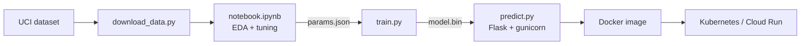

# Online Shopper Purchase-Intent Prediction

**Midterm project · Machine Learning Zoomcamp 2026 (DataTalks.Club)**

A machine-learning service that estimates, from the browsing behaviour recorded in one web session, how likely the visitor is to **make a purchase**. The model is trained on the UCI *Online Shoppers Purchasing Intention* dataset, exposed through a Flask REST API, packaged with Docker and ready to deploy on Kubernetes or Google Cloud Run.



---

## 1. Problem description

An online shop records thousands of browsing sessions, but only a small share of them end in a purchase. Knowing *how likely* a session is to convert lets the shop spend its attention (and discounts) where they matter:

* show a discount or live-chat prompt to a hesitant visitor with moderate-to-high purchase intent;
* avoid giving a coupon to someone who is going to buy anyway;
* retarget visitors who left with a high score but did not buy;
* measure which traffic sources and campaigns bring high-intent visitors.

**Task:** binary classification. Input: the features of one session (pages viewed per category, time spent, bounce/exit rates, page value, month, visitor type, traffic source, ...). Output: the probability that the session ends with a purchase (`Revenue = 1`), plus a yes/no decision using a tuned threshold.

**How the model is used:** the trained pipeline is wrapped in a REST API (`POST /predict`). A web shop backend, or a marketing-automation tool, sends the session features and gets the purchase probability back.

**Why not just accuracy?** Only about 15 % of the sessions convert, so a model that always answers "no purchase" is already ~85 % accurate. The project therefore selects models on **ROC-AUC**, reports **PR-AUC**, and chooses the decision threshold by maximising **F1**.

## 2. Dataset

| | |
|---|---|
| Source | [UCI Machine Learning Repository, dataset 468](https://archive.ics.uci.edu/dataset/468) |
| Size | 12,330 sessions (one row each), 17 features + target, ~1 MB |
| Target | `Revenue` (the session ended with a purchase) — about 15.5 % positives |
| License | CC BY 4.0 |
| Citation | Sakar, C.O., Polat, S.O., Katircioglu, M., Kastro, Y. (2019). *Real-time prediction of online shoppers' purchasing intention using multilayer perceptron and LSTM recurrent neural networks.* Neural Computing and Applications, 31, 6893–6908. |

The dataset is **not stored in this repository**. It is downloaded by a script (see [Reproducing the project](#6-reproducing-the-project)); if the download ever fails, get the CSV from the UCI page and save it as `data/online_shoppers_intention.csv`.

### Features

| Feature | Description |
|---|---|
| `Administrative`, `Administrative_Duration` | number of account-management pages visited, and time spent on them |
| `Informational`, `Informational_Duration` | same for informational pages (about, contact, ...) |
| `ProductRelated`, `ProductRelated_Duration` | same for product pages |
| `BounceRates` | average bounce rate of the visited pages (Google Analytics) |
| `ExitRates` | average exit rate of the visited pages |
| `PageValues` | average value of the visited pages before a transaction |
| `SpecialDay` | closeness of the visit to a special day (Mother's Day, Valentine's Day, ...), 0–1 |
| `Month` | month of the visit |
| `OperatingSystems`, `Browser`, `Region`, `TrafficType` | integer codes (categories without order) |
| `VisitorType` | `Returning_Visitor`, `New_Visitor` or `Other` |
| `Weekend` | the visit happened on a weekend |
| **`Revenue`** | **target:** did the session end in a purchase? |

## 3. Repository layout

```
midterm-project/
├── README.md                this file
├── notebook.ipynb           data prep, EDA, feature importance, model selection, tuning, evaluation
├── common.py                shared code: schema, cleaning, feature engineering, pipelines, metrics
├── train.py                 trains the final model and saves model.bin + reports/metrics.json
├── predict.py               Flask service that loads model.bin and serves /predict
├── predict_test.py          sends sample_session.json to a running service
├── download_data.py         downloads the dataset into data/
├── params.json              hyper-parameters per model (written by the notebook, read by train.py)
├── sample_session.json      example request body
├── requirements.txt         pinned runtime / training dependencies
├── requirements-dev.txt     + notebook dependencies (matplotlib, seaborn, jupyter)
├── Dockerfile               container image (trains the model while building)
└── deployment/k8s/          Kubernetes manifests (Deployment + Service)
```

Generated locally and not committed: `data/` (dataset) and `model.bin` (trained model).

## 4. Approach

**Data preparation** (`common.clean_dataset`)
* parse the boolean columns, normalise the month names (the raw file spells *June* in full, every other month is abbreviated);
* **drop duplicated sessions** before splitting, so that identical rows cannot end up in both train and test;
* integer-coded columns (`OperatingSystems`, `Browser`, `Region`, `TrafficType`) are treated as categories.

**Exploratory data analysis** (`notebook.ipynb`, sections 1–3)
* data-quality checks (missing values, duplicates, value ranges, category spelling);
* target distribution and class imbalance;
* distributions of every numeric feature by class (log-scaled: the features are right-skewed and zero-inflated), share of zeros;
* a closer look at `PageValues`;
* conversion rate per category (month, visitor type, weekend, traffic type, region, browser, operating system);
* correlation matrix of the numeric features;
* univariate feature importance: ROC-AUC for numeric features, mutual information for categorical features.

**Feature engineering** (`common.engineer`, part of the saved pipeline, so it also runs at prediction time): `total_pages`, `total_duration`, `avg_seconds_per_page`, `product_page_share`, `has_page_value`.

**Models.** Four families are compared: logistic regression (linear baseline, with log-transformed and standardised numeric features), decision tree, random forest and XGBoost. Everything is a single scikit-learn `Pipeline` (feature engineering → one-hot encoding → model).

**Validation protocol**
1. stratified 80/20 split; the 20 % test set is touched **once**, at the end;
2. 5-fold stratified cross-validation on the 80 % for baselines and for hyper-parameter search (`RandomizedSearchCV`, ROC-AUC);
3. the best tuned model is selected by CV ROC-AUC;
4. the decision threshold is the F1-optimal threshold on **out-of-fold** training predictions (never tuned on the test set);
5. final evaluation on the test set with ROC-AUC, PR-AUC, precision, recall, F1 and the confusion matrix, both at the default 0.5 threshold and at the tuned threshold;
6. permutation importance on the test set shows which features drive the predictions.

## 5. Results

The metrics of the trained model are produced by the scripts rather than copied by hand:

* `python train.py` prints the cross-validation table and the test-set metrics, and saves them to `reports/metrics.json`;
* the notebook (sections 4–7) shows the baseline vs. tuned comparison, ROC/PR curves, the confusion matrix and the feature importances.

## 6. Reproducing the project

You need **Python 3.11+** (NumPy 2.3 requires it). All commands are run from the `midterm-project` folder.

### 6.1 Environment

```bash
# macOS / Linux
python -m venv .venv
source .venv/bin/activate
pip install -r requirements-dev.txt     # use requirements.txt if you only want to train/serve
```

```powershell
# Windows PowerShell
python -m venv .venv
.venv\Scripts\Activate.ps1
pip install -r requirements-dev.txt
```

With [uv](https://docs.astral.sh/uv/): `uv venv --python 3.11` then `uv pip install -r requirements-dev.txt`.

### 6.2 Data

```bash
python download_data.py          # saves data/online_shoppers_intention.csv (skipped if present)
```

### 6.3 Notebook

```bash
jupyter lab                      # open notebook.ipynb and run all cells
# or run it headless and keep the outputs in the file:
jupyter nbconvert --to notebook --execute --inplace notebook.ipynb
```

The hyper-parameter search takes a few minutes (reduce `N_ITER` in section 5 to speed it up). The last cell writes the tuned hyper-parameters to `params.json`.

### 6.4 Train the final model

```bash
python train.py
```

This cross-validates the four candidates with the parameters in `params.json`, selects the best one, tunes the threshold, evaluates on the held-out test set and writes `model.bin` and `reports/metrics.json`.

### 6.5 Run the web service locally

```bash
python predict.py                                        # development server, works on every OS
# macOS / Linux (production server, as used in Docker):
gunicorn --bind 0.0.0.0:9696 predict:app
```

### 6.6 Try it

```bash
python predict_test.py                                   # uses sample_session.json
curl -X POST http://localhost:9696/predict -H "Content-Type: application/json" -d @sample_session.json
```

```powershell
Invoke-RestMethod -Method Post -Uri http://localhost:9696/predict -ContentType "application/json" -Body (Get-Content sample_session.json -Raw)
```

## 7. API reference

| Method | Path | Description |
|---|---|---|
| `GET` | `/` | service and model information, list of required fields |
| `GET` | `/health` | health check used by Docker/Kubernetes probes |
| `POST` | `/predict` | score one session |

**Request body** (all 17 fields are required; see `sample_session.json`)

| Field | Type / allowed values |
|---|---|
| `Administrative`, `Informational`, `ProductRelated` | integer ≥ 0 |
| `Administrative_Duration`, `Informational_Duration`, `ProductRelated_Duration`, `PageValues` | number ≥ 0 |
| `BounceRates`, `ExitRates`, `SpecialDay` | number between 0 and 1 |
| `Month` | month name, e.g. `"Feb"`, `"June"`, `"Nov"` |
| `OperatingSystems`, `Browser`, `Region`, `TrafficType` | positive integer code |
| `VisitorType` | `"Returning_Visitor"`, `"New_Visitor"` or `"Other"` |
| `Weekend` | `true` / `false` |

**Response** (illustrative values)

```json
{
  "purchase_probability": 0.8123,
  "will_purchase": true,
  "threshold": 0.3321,
  "model": "xgboost"
}
```

Invalid input returns HTTP 400 with the reasons, for example:

```json
{"error": "Invalid input", "details": ["BounceRates must be <= 1", "VisitorType must be one of ['Returning_Visitor', 'New_Visitor', 'Other']"]}
```

## 8. Docker

The image trains the model while it is built (it downloads the dataset and runs `train.py`), so a fresh clone needs nothing but Docker and an internet connection for the first build.

```bash
docker build -t shopper-intent:v1 .
docker run --rm -p 9696:9696 shopper-intent:v1
python predict_test.py                    # in a second terminal
```

The container listens on `$PORT` (default `9696`) and runs `gunicorn` as a non-root user.

## 9. Kubernetes (local cluster with kind)

Manifests are in `deployment/k8s/` (a Deployment with 2 replicas, resource limits and readiness/liveness probes on `/health`, plus a Service).

```bash
kind create cluster --name shopper
kind load docker-image shopper-intent:v1 --name shopper     # make the local image available to the cluster
kubectl apply -f deployment/k8s/
kubectl rollout status deployment/shopper-intent
kubectl port-forward service/shopper-intent 8080:80          # keep this running
python predict_test.py http://localhost:8080                 # in a second terminal
```

Clean up with `kubectl delete -f deployment/k8s/` and `kind delete cluster --name shopper`.

## 10. Cloud deployment (Google Cloud Run)

The container honours the `$PORT` variable that Cloud Run injects, so the same image runs unchanged. Build and deploy straight from the `Dockerfile`:

```bash
gcloud auth login
gcloud config set project <PROJECT_ID>
gcloud services enable run.googleapis.com cloudbuild.googleapis.com artifactregistry.googleapis.com

gcloud run deploy shopper-intent --source . \
  --region asia-southeast1 --allow-unauthenticated --memory 1Gi

# the command prints the service URL
python predict_test.py https://<SERVICE_URL>
```

Delete the service afterwards with `gcloud run services delete shopper-intent --region asia-southeast1`. Any other host that runs Docker images (Render, Fly.io, ...) works the same way.

<!-- After deploying, add a screenshot of the test here, e.g.  -->

## 11. Design decisions and limitations

* **One pipeline object.** Feature engineering, encoding and the model are saved together, so the API cannot drift away from the training code.
* **Dense preprocessing output.** XGBoost treats the missing entries of a sparse matrix as NaN, so training and single-row inference could otherwise behave differently.
* **`params.json` links notebook and script.** Tuning happens in the notebook; `train.py` stays fast and deterministic and is what the Docker build runs.
* **Whole-session features.** `PageValues`, `BounceRates` and `ExitRates` are aggregated over the entire session, so the service scores completed (or nearly completed) sessions rather than predicting at the very start of a visit. `PageValues` in particular is defined relative to transactions, which makes it a very strong but partly "late" signal.
* **Limited scope of the data:** a single shop, ten months of traffic. Seasonality (Month) may not generalise to other years or shops, and time-based validation would be the natural next step.
* **Model file format:** the model is stored with `pickle`; only load model files you created yourself, and keep the library versions pinned to those in `requirements.txt`.

**Ideas for improvement:** probability calibration, a cost-sensitive threshold (value of a recovered sale vs. cost of a discount), session-sequence features, monitoring of input drift in production.

## 12. Credits

Dataset: Sakar et al. (2019), UCI Machine Learning Repository, CC BY 4.0. Course: [Machine Learning Zoomcamp](https://github.com/DataTalksClub/machine-learning-zoomcamp) by DataTalks.Club.
